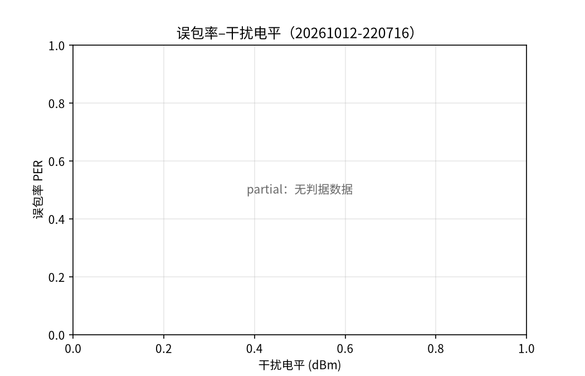
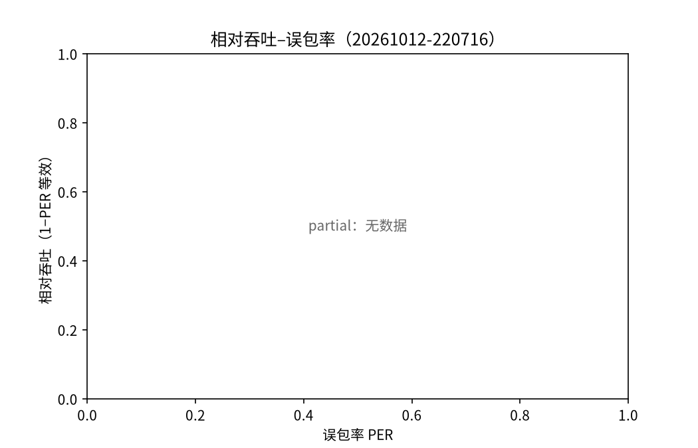
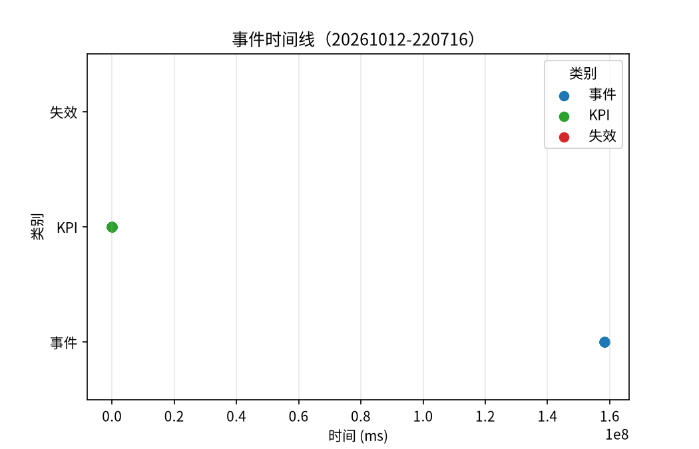

# Run Report（20261012-220716）

## 运行概要

| 项 | 值 |
| --- | --- |
| 运行目录 | /mnt/data/Code/autoC/workspace/chuangxin2026/runs/20261012-220716 |
| 运行标识 | 20261012-220716 |
| 后端 | sim |
| 时钟基准 | software |
| kpi.csv | 存在，30 行 |
| events.jsonl | 存在，16 条 |
| monitor.csv | 存在，0 行 |

## 三元曲线

绘制口径：本次绘制（font=cjk，partial=True）；缺帧：frame_a、frame_b；partial 成因：no_judged_windows

## 失效电平对比

无失效数据：result['failure_levels'] 为空——跳过失效电平对比段（不虚构对比表）

## 样式识别

未识别（无模型）——不阻塞主流程

## 频点图谱位

实有频点：monitor.csv 存在但无频点行（0 个）。
频点口径：一期频点按 2.4G/5.8G 实有频点如实标注（未提供 freq_plots 登记，按 monitor.csv 实测频点如实计位）
图谱位：实有 0/需 5
缺 5 个频点图（实有 0/需 5；未登记任何频点键）

## 缺项汇总（result 与文件双源核对）

- models/style_classifier.json（样式识别模型不存在——识别段未识别）
- 频点图谱位（缺 5 个频点图（实有 0/需 5；未登记任何频点键））

## 口径声明（脚注）

> 报告全局口径：测量环境为屏蔽盒环境，全部结论仅在该环境内成立。
> 受试对象仅限自建链路（自研发射/接收/馈线组合），不外推至其他受试设备。
> 定位为 GB 42590 方法学预研：全文结论为方法学预研性质，非标准符合性测试。
> 非 CISPR 意义上的测量：数据不可用于认证或符合性声明。
> 数字纪律：报告关键数字均可回溯至原始数据文件，不做无出处修饰。
> 报告中模拟部分均已标注

> 报告上下文：后端 = sim
> 报告上下文：时钟基准 = software
> 报告上下文：运行标识 = 20261012-220716
> 口径：误码指标以 PER（分组差错率）呈现，由 BER 换算得到，非直接测得的 BER。
> 报告涉及模拟段：sim 后端全流程（模拟链路演示）（读数适用下方 emc 级声明）

> EMC 摸底段口径：全部读数由模拟后端产生（simulated 读数），非 CISPR 16-1-1 测量接收机实测值。
> 限值线比对结论仅用于演示余量计算方法，不构成符合性判定。
> 本测试为模拟演示，全部读数带 simulated 标记
